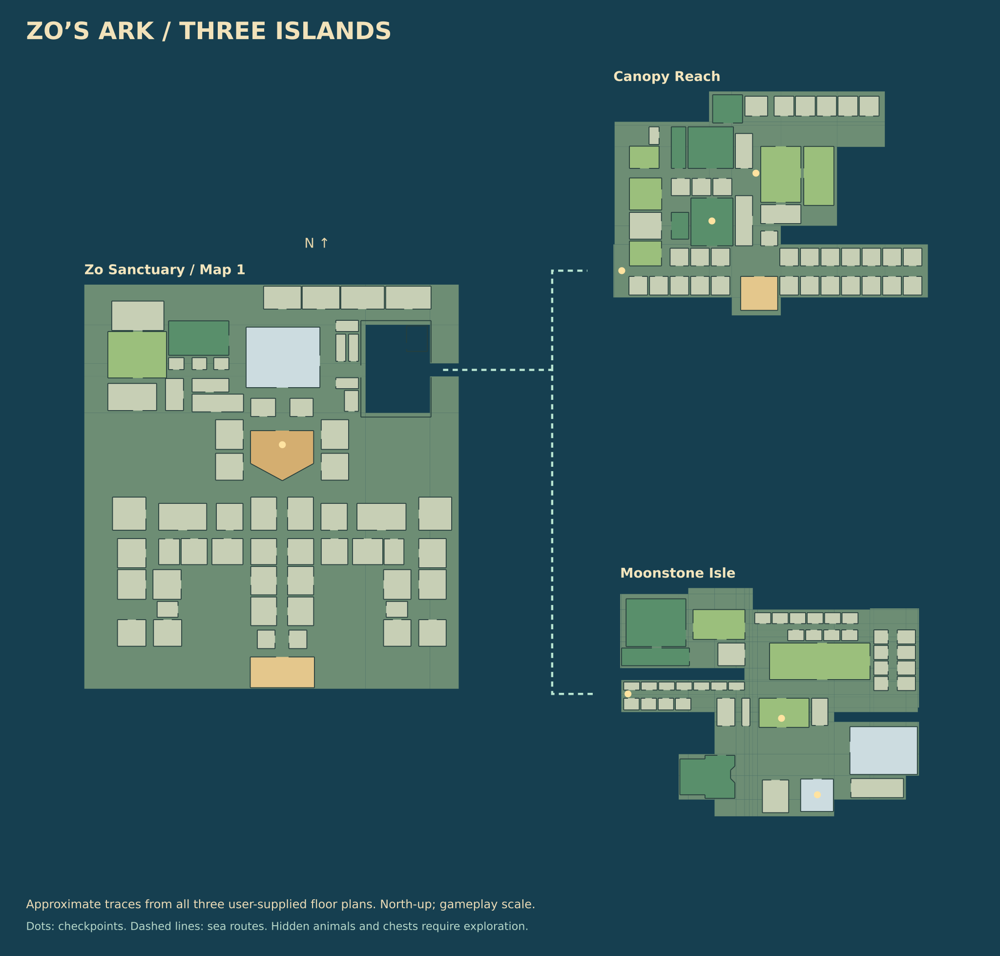

# Three islands from the user's floor plans

The two additional inline floor-plan images are references for new land masses around the sea. They are hand-traced gameplay adaptations, with north at the top and east at the right. Original image binaries are not present in this checkout. No architectural dimensions or construction instructions are inferred from the images. Smaller partitions are consolidated and roofs are omitted, following the original hybrid-campus direction.

| Reference | Island | Retained features | Gameplay |
| --- | --- | --- | --- |
| First additional image | Canopy Reach, northeast | Northern room row, western complex, eastern paired halls, long lower galleries and southern arrival hall | 48 rooms, 6 habitats, 3 checkpoints, 4 chests; meadow/canopy wildlife and a secluded water cove |
| Second additional image | Moonstone Isle, southeast | Northwest court, upper/east gallery loop, central cross-gallery, southwest pointed hall and southeast great hall | 43 rooms, 7 habitats, 3 checkpoints, 4 chests; meadow, canopy, mountain and secluded reef wildlife |

`IslandLayouts.luau` is authoritative. Both traces use a 1426×1104 reference canvas at 0.55 studs per reference pixel. Canopy is offset to world (1150, -650), Moonstone to (1150, 500). These are gameplay positions/scales rather than recovered measurements. `MapGeometry.world` preserves the original Ark transform when no offset is supplied.

Land masses are unions of footprint rectangles, extruded below the seabed. They preserve stepped/C-shaped coastlines and leave water coves open. Gallery and room geometry uses the same door-gap calculations as the original Ark. Each island has a west-facing landing pier, swim steps, two free boats and additional shore exits. The original Ark has its three boats. Terrain water/seabed fills are chunked within `Config.SeaBounds`; the sea route at world X≈650 links all three landings.

The checkpoint and chest coordinates live in the layouts; stable IDs, names, expedition goals and chest outcomes live in `Catalog.luau`. The in-game chart draws all three plans but reveals interior checkpoint markers only after activation. Hidden wildlife and chests have no chart markers. Development diagrams include checkpoint positions to support route review.

The default world targets 81 ordinary animals and two event mantas. Visible habitat pools contain Common/Uncommon species; Rare+ pools are restricted to out-of-the-way rooms, alcoves and coves. Wild animals retain their original home population slot while roaming, so visiting another room does not create duplicate spawns. Common/Uncommon land animals may pathfind through doorways on their own island; rare and marine wildlife roam within their secluded home habitat. Pathfinding, wall sweeps, streaming and character/boat boarding require actual Studio tests.

`scripts/island_assets.py` exports an overview from real game data and checks every island room, checkpoint, chest and shore approach for structural walking access. It also checks conservative boat clearance between the Ark gate and both landings, correct water/ground habitats, and nonoverlapping footprints. These planar checks exclude props and do not execute Roblox navigation, terrain, collision or physics. Run `bash scripts/check.sh` to regenerate both SVG diagrams and build the place.
