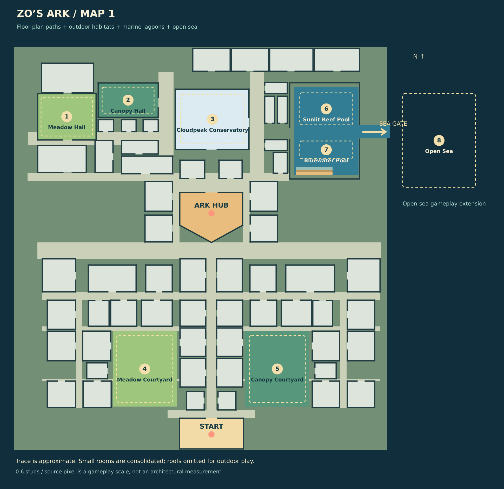

# Map 1: the Ark base, outdoor biomes and open sea

The user provided `MAP 1.jpeg` as an inline architectural floor-plan image and chose a **mix of a sanctuary complex and an outdoor world**. This version follows that direction. The original attachment is not a local asset in the repository; the authored trace is `src/shared/MapLayout.luau`.

## What the image becomes

| Visible source feature | Game interpretation |
| --- | --- |
| Southern entrance block | Player arrival lobby and welcome point |
| Long central lower spine | Main outdoor avenue linking the entrance, courtyards and north campus |
| Lower horizontal gallery and flanking room groups | Walkable discovery galleries, field rooms and future activity spaces |
| Large lower open areas to either side of the spine | Meadow Courtyard and Canopy Courtyard, with live animal encounters |
| Distinctive central pointed hall | Ark Atrium: sanctuary trading, gear store and challenge board; entrance on its north side |
| Northern western rooms | Meadow Hall, nursery and Canopy Hall |
| Upper central room cluster | Cloudpeak Conservatory, consolidated into a mountain habitat |
| Large eastern hall | Tidewater Hall, with connected reef/bluewater lagoons and a low boarding dock |
| Eastern hall opening | A widened sea gate leading to an added open-sea encounter area |

The base remains recognizable through its north-up orientation, entrance axis, pointed hall, flanking blocks, gallery rows and eastern hall. Roofs are omitted, habitat walls are low, and grass, trees, rocks and sea routes make it an outdoor adventure. The surrounding lawn and open-sea area are gameplay additions. The marine hall is one continuous water area with two encounter zones.

The Ark trace now contains 64 simplified room outlines and 12 habitat zones, including a coral alcove and secluded side-room habitats. Other side rooms remain circulation or decorative space; room names do not imply extra stores, working clinics or a second floor. Animal art is still procedural. The two additional islands are documented in [ISLANDS_DESIGN.md](ISLANDS_DESIGN.md).

## Scale and fidelity

Coordinates refer to an approximately 1530×1632 image canvas. Image top maps to world north (negative Z); image right maps to positive X. The campus uses **0.6 Roblox studs per image pixel**, centered near the middle of the parcel. This is a gameplay scale, not a measurement recovered from architectural dimensions. No claim is made that individual partitions or doors are survey-accurate.

Small partitions are consolidated where needed for movement and animal encounters. Source labels, construction/control-joint notes and measurements were treated as reference annotations, not instructions. The source image itself is unchanged.

## Data and generation

- `MapLayout.luau` defines rooms, door openings, corridors, courtyards, habitat rectangles, water cutouts, spawn, hub, boarding transitions and boats in source-image coordinates.
- `MapGeometry.luau` converts coordinates and supplies the same wall segments and foundation cutouts to the world builder, chart and structural checks.
- `PlanWorld.luau` generates the roofless 3D campus at server start. Foundation pieces leave the marine pools and sea gate open for Terrain water.
- Dry foundation columns now extend below `SeabedY` and meet a continuous rock seabed. They block swimming beneath the island without closing the marine cutouts. `ShoreExits` adds four stairways on the outer north, south, east and west edges, shown as EXIT on the in-game chart. Recovery pickups are scattered in water around these exits and the marine habitats.
- `World.luau` samples wildlife with body clearance inside each habitat. Movement checks stop simple roaming paths from crossing walls, and captures require a clear server-checked view.
- The chart preserves proportions and draws the actual trace, with numbered habitats, the entrance, Ark hub and live player marker. Imported Studio maps use their own marker positions instead.

Run `bash scripts/check.sh` to validate the source, map geometry and routes, regenerate `docs/map-1-layout.svg`, and build `build/ZosArk.rbxlx`. The layout JSON in `build/map-1-layout.json` is a generated export for inspection, not an authored source file.

## Outdoor forests

The Ark now has 160 broadleaf, birch, pine and palm trees plus 180 ferns, flower clumps, mossy stones and logs. ForestryLayout derives placement from the existing dry footprint, rooms, courtyards, corridors and markers. Forest groups leave the entrance, central avenue, Atrium, marine wing, shore steps and habitat gathering areas clear. Scenery has no collision/query surfaces to interfere with animal movement or rescue checks. This replaces the former sparse corner trees without changing the floor-plan trace.

## Remaining Studio work

The cloud checks verify the layout and source build, not Roblox physics. In Studio, test walking every route, the north atrium entrance, wall/camera behavior, habitat spawning, boat turning and boarding, the sea gate, swimming exits, streaming, and phone/tablet chart layout. Tune widths and heights from those results before publishing.
